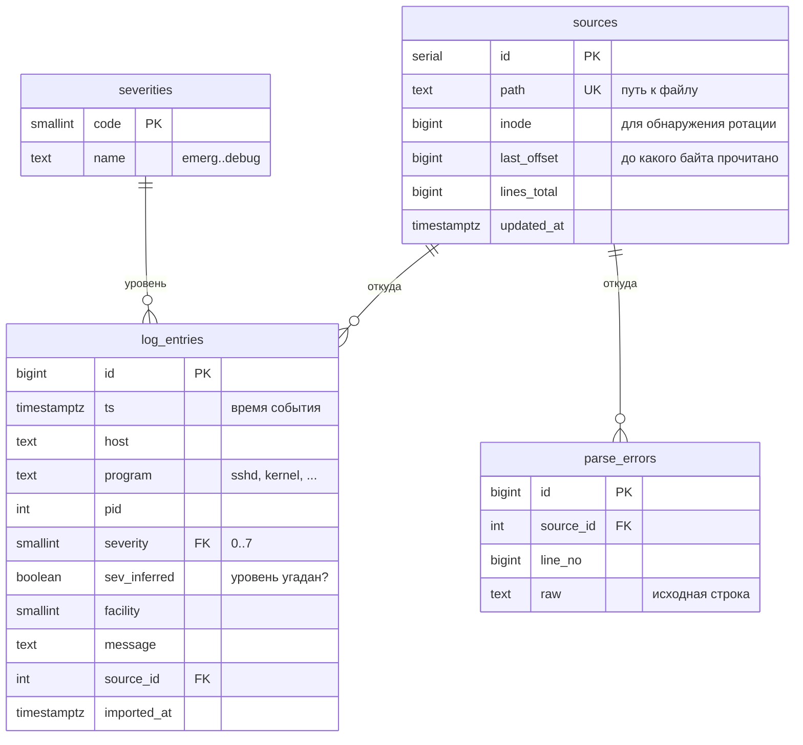

# Прототип базы данных

PostgreSQL 13+. Полная схема лежит в [`sql/schema.sql`](../sql/schema.sql).

## ER-диаграмма

## Таблицы

| Таблица | Зачем нужна |
|---|---|
| `log_entries` | основные данные: одна строка лога соответствует одной записи |
| `sources` | файлы-источники и позиция чтения в каждом. Повторный `import` дочитывает только новые строки. Если сменился `inode`, значит прошла ротация логов, и файл читается с начала |
| `severities` | справочник уровней по RFC 5424: 0 emerg … 7 debug |
| `parse_errors` | строки, которые не удалось разобрать. Данные не теряются, формат можно доработать позже |

## Индексы и запросы, которые они ускоряют

| Индекс | Тип | Запрос |
|---|---|---|
| `log_entries_ts_brin` | BRIN (ts) | диапазоны по времени. Логи пишутся почти по порядку, поэтому индекс занимает килобайты |
| `log_entries_sev_ts` | B-tree (severity, ts) | `search -l err -s 1h` |
| `log_entries_prog_ts` | B-tree (program, ts) | `search -p sshd` |
| `log_entries_msg_trgm` | GIN + pg_trgm | `search -g "failed password"`, то есть `ILIKE '%…%'` |

## Представления и функции

- `v_severity_stats`: количество записей по уровням.
- `v_errors_hourly`: ошибки и предупреждения по часам.
- `purge_logs('30 days')`: удаляет записи старше заданного срока (retention).

## Загрузка

Данные загружаются через `COPY ... FROM STDIN`, это в разы быстрее построчных `INSERT`.
Импорт одного файла выполняется в **одной транзакции**: либо файл загружен целиком, либо не загружено ничего.
На время импорта строка в `sources` блокируется (`SELECT ... FOR UPDATE`), поэтому два параллельных импорта одного файла не создадут дублей.

## Что можно сделать дальше

- Партиционировать `log_entries` по месяцам (`PARTITION BY RANGE (ts)`): старые данные удаляются через `DROP PARTITION` мгновенно.
- Вынести `host` и `program` в справочники, если объём вырастет до десятков миллионов строк.
- Добавить материализованные представления для тяжёлой статистики.
