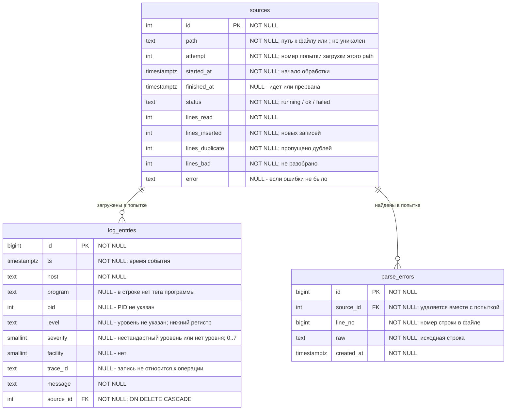

# База данных

Основная проверяемая конфигурация — PostgreSQL 16. Схема лежит в [`sql/schema.sql`](../sql/schema.sql). В Docker Compose она применяется автоматически при первом запуске.

## ER-диаграмма

`NOT NULL` — поле обязательно. `NULL` — поле может быть пустым, и в комментарии сказано, когда это бывает.



## Что изменилось в версии 0.2 и почему

| Было в 0.1 | Стало в 0.2 | Причина |
|---|---|---|
| Справочник `severities` и внешний ключ на него | Справочника нет. `level text` хранит уровень как в логе (`error`, `fatal`, `trace`, `audit`), а `severity smallint` хранит код 0..7, если он известен | Справочник не давал сохранить нестандартный уровень (FATAL, TRACE). Замена такого уровня на `unknown` теряла бы информацию |
| `sev_inferred`: уровень угадывался по словам error/fail в тексте | Поля нет. Уровень берётся только из явной разметки: `<PRI>`, `[ERROR]`, `FATAL:`, `level=` | Угадывание ненадёжно: слово «failed» встречается и в обычных info-сообщениях |
| `sources`: одна строка на файл, `path` UNIQUE, `inode`, `last_offset`, `lines_total`, `updated_at` | `sources`: одна строка на **попытку** импорта, `attempt` — номер попытки, `started_at` / `finished_at`, `status`, счётчики, `error` | Утилита не следит за файлами постоянно: пользователь сам запускает импорт. Поэтому позиция в файле и inode не нужны, а важна история попыток, в том числе неудачных |
| `log_entries.imported_at` | Удалено. Время загрузки берётся из `sources.started_at` по `source_id` | Время дублировалось. Кроме того, «imported_at» у записи и время попытки — разные вещи: попытка может завершиться ошибкой |
| Дубликаты при повторном импорте отсекались только по позиции в файле | Уникальный индекс `log_entries_uniq` и `INSERT ... ON CONFLICT DO NOTHING` | Тот же файл, загруженный ещё раз (или скопированный под другим именем), не искажает статистику |
| — | `trace_id` и представление `v_operations` | Связать записи одной операции, посчитать её длительность, найти самые долгие |

## Уровни (level / severity)

- `level` всегда в нижнем регистре: это гарантирует `CHECK (level = lower(level))`. Синонимы приводятся к одному имени: `ERR` и `Error` становятся `error`, `WARN` становится `warning`.
- Самостоятельные уровни сохраняются под своим именем. `fatal` остаётся `fatal` и получает код 2 (как critical), а `trace` остаётся `trace` и получает код 7 (как debug). Код нужен для сортировки и фильтра `--level error`, где показываются записи «не ниже error».
- Нестандартный уровень (например `audit`) сохраняется как есть, со значением `severity = NULL`. При импорте утилита предупреждает об этом и называет уровень. Найти такие записи можно командой `search --level-is audit`.
- Если уровня в строке нет, то `level = NULL` (в выводе показывается «-»).
- Цвета в БД не хранятся, это задача интерфейса (`ui.c`).

## Защита от дубликатов

```sql
CREATE UNIQUE INDEX log_entries_uniq ON log_entries
    (ts, host, coalesce(program, ''), coalesce(pid, -1), coalesce(level, ''), md5(message));
```

`coalesce` нужен потому, что `NULL` не равен `NULL`. Без него две одинаковые строки без PID не считались бы дублями. `md5(message)` держит индекс компактным при длинных сообщениях.

Загрузка идёт в два шага:
1. `COPY` во временную таблицу `stage`. Это быстро, обычный `COPY` не умеет `ON CONFLICT`.
2. `INSERT INTO log_entries SELECT ... FROM stage ON CONFLICT DO NOTHING`. Число вставленных строк — это новые записи, а разница с числом разобранных строк — дубликаты.

## Попытки импорта

Строка в `sources` создаётся **отдельной транзакцией до начала загрузки**. Загрузка данных идёт во второй транзакции: при ошибке она полностью откатывается, а попытка остаётся в истории со статусом `failed` и текстом ошибки. Историю можно посмотреть командой `logparser sources`.

## Индексы

Базовый набор сокращён. Для списка событий используется B-tree (ts,id), для конкретной операции - частичный B-tree (trace_id,ts,id). Индексы уникальности и source_id остаются. Полный разбор назначения каждого индекса, примеры и ограничения: [indexes.md](indexes.md).

## Очистка

`logparser clear` выполняет `TRUNCATE log_entries, parse_errors, sources RESTART IDENTITY`. Данные удаляются, а таблицы, индексы и представления остаются, поэтому `init` повторять не нужно. Сервер PostgreSQL при этом не трогается.


## Исправления после созвона

sources.id использует GENERATED ALWAYS AS IDENTITY, как идентификаторы остальных таблиц. UNIQUE-индекс sources_path_attempt_key защищает (path,attempt), CHECK требует положительный attempt. db_source_start открывает короткую транзакцию и берёт SHARE ROW EXCLUSIVE на sources перед MAX+1. Это простой компромисс для учебной утилиты: регистрации сериализованы, но чтение файлов и COPY идут после освобождения блокировки. Одного UNIQUE без синхронизации недостаточно для успешной конкурентной регистрации.

source_id в log_entries теперь NOT NULL и ON DELETE CASCADE. Индексы log_entries_source и parse_errors_source поддерживают поиск дочерних строк при удалении. purge_logs(keep) удаляет целые завершённые попытки по started_at и возвращает число попыток. running не удаляются. clear сохраняет прежнюю семантику полной очистки.

Дедупликация глобальна: событие принадлежит первой вставившей его попытке. История последующего импорта с 19 дублями не содержит 19 резервных событий. После удаления владельца запись исчезнет, а повторный импорт сможет добавить её заново. Это нужно согласовать с преподавателем; если требуется сохранять событие до удаления всех импортов, нужна отдельная связь многие-ко-многим, которой здесь нет.

## Обновление существующего тома

Docker init-скрипт выполняется только для пустого тома. Пересборка образа не обновляет существующие таблицы. В этой учебной версии используем новую тестовую базу: порядок пересоздания приведён в README, раздел «Создание новой тестовой базы». Старые логи и история при удалении тестового тома теряются.

## Проверка пользы индексов

См. [indexes.md](indexes.md) и [sql/check_indexes.sql](../sql/check_indexes.sql). Нужный набор индексов создаётся вместе с новой базой из schema.sql. check_indexes.sql нужен только для диагностики и не требуется для запуска приложения.
