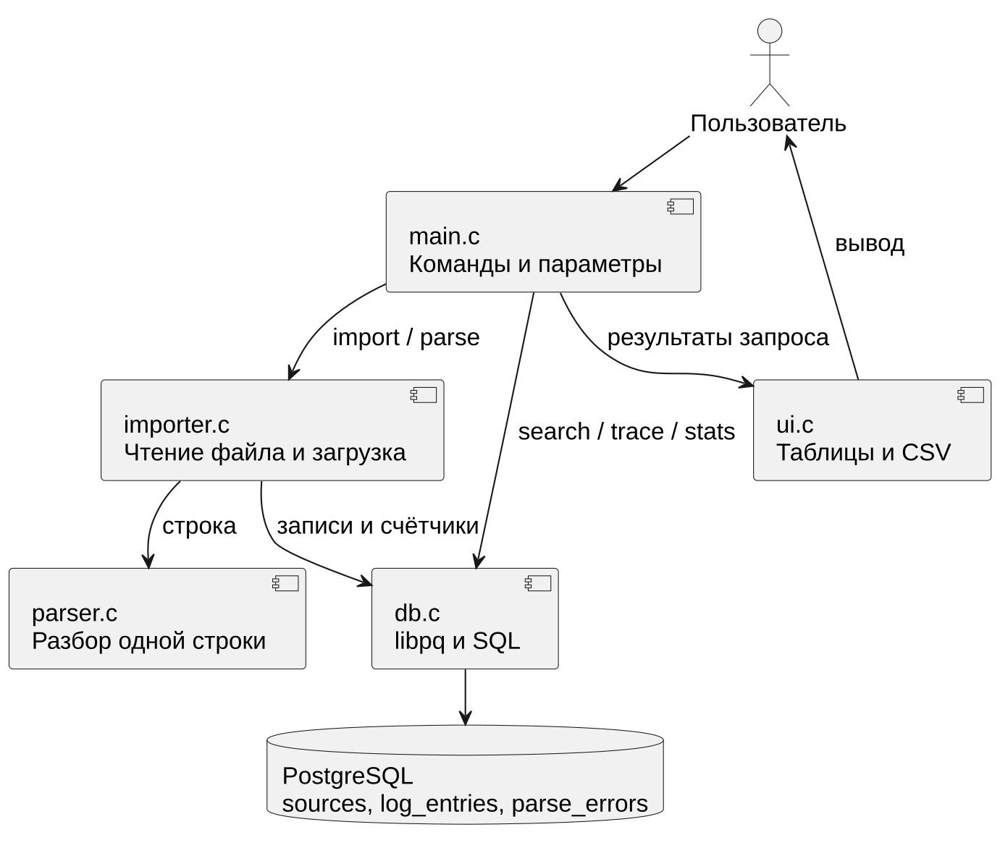
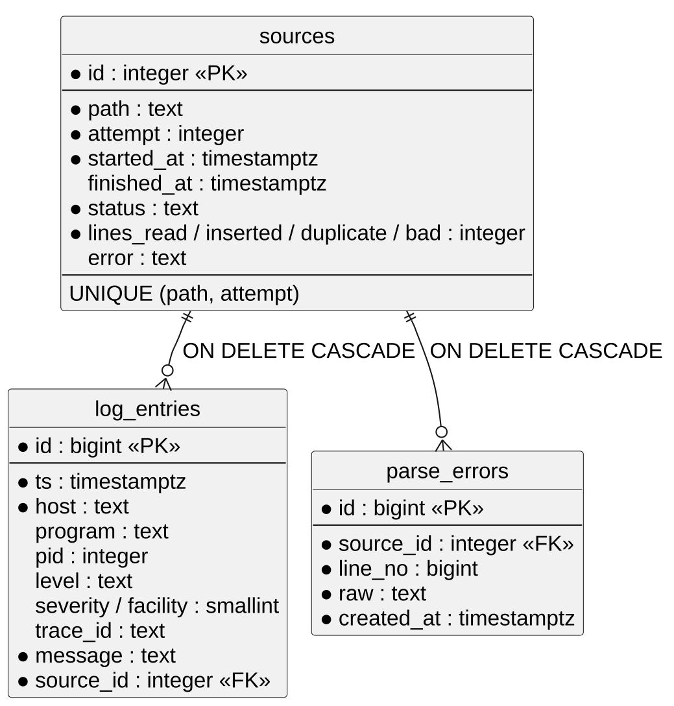
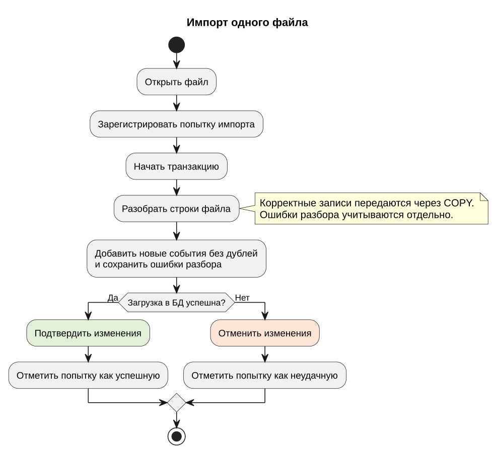

# Техническое задание


## Система разбора, хранения и анализа журналов LogParser


Редакция для согласования на 2 ноября 2026 года. Структура построена по разделам ГОСТ 34.602-2020 [8]. Требования определяют целевое поведение; степень их выполнения показана в разделе 4 записки. Настоящий текст не является протоколом утверждения или завершённой приёмки.

## 1 Общие сведения

Полное наименование: система разбора, хранения и анализа системных и прикладных журналов LogParser. Разработчик - учебная команда ARCA Technologies: Александр, Алексей и Руслан. Основание - учебное задание и замечания преподавателей, включая обсуждение от 29 октября 2026 года.
Получатель результата - руководитель учебного проекта. Организационные реквизиты дисциплины, группы, руководителя и дата окончательной сдачи подлежат согласованию при утверждении титульного листа. Специальное финансирование в рамках данного ТЗ не устанавливается.
Промежуточный комплект документации предъявляется к 3 ноября 2026 года. Исходные тексты хранятся в GitHub. ТЗ должно иметь текстовую версию Markdown; версия DOCX предназначена для чтения и рецензирования. Изменения объёма работ фиксируются в истории документа и согласуются командой с руководителем.

## 2 Цели и назначение создания системы

Назначение системы - анализ подготовленных файлов журналов посредством их загрузки в PostgreSQL и последующих команд поиска и статистики. Непрерывный сбор событий с серверов в объём работ не входит.
Критерии достижения цели: корректные записи контрольного набора доступны после загрузки; повторный импорт не увеличивает число уникальных событий; фильтры дают ожидаемую выборку; trace восстанавливает временную последовательность; история показывает результат попыток; очистка не требует повторного создания схемы.
Сокращение времени работы пользователя является ожидаемым эффектом. Количественное ускорение относительно ручного анализа не устанавливается без отдельного эксперимента.

## 3 Характеристика объекта автоматизации

Объект - работа разработчика или специалиста сопровождения с журналами нескольких программ и хостов. Входные данные предоставляются файлами UTF-8 либо стандартным вводом. Одна физическая строка рассматривается как одна запись.
Эксплуатация предполагается на локальном компьютере с доступом к PostgreSQL. Контейнерный вариант использует Docker Compose. Для получения образов нужен доступ к сети; при локальной БД и уже загруженных образах внешняя сеть для анализа не обязательна.
Многопользовательский веб-доступ, отдельная система ролей приложения, автоматическая доставка файлов и восстановление многострочных исключений не входят в обязательный объём.

## 4 Требования к автоматизированной системе

### 4.1 Требования к структуре

Система должна включать модули разбора, импорта, доступа к БД и интерфейса. Разбор файла без сохранения должен быть доступен без подключения к PostgreSQL. Хранилище должно обеспечивать постоянство данных между запусками. Пользовательские операции выполняются отдельными CLI-командами.



[Исходник PlantUML: Архитектура LogParser](diagrams/architecture.puml)

### 4.2 Требования к функциям

Таблица А1 - Функциональные требования

| Код | Функция | Проверяемый результат |
| --- | --- | --- |
| Ф1 | init | Создаётся схема новой БД; ошибочное подключение диагностируется |
| Ф2 | parse | Строки разобраны без БД; некорректные строки отмечены |
| Ф3 | import | Загружаются один или несколько файлов либо stdin; выводятся счётчики |
| Ф4 | Повторный импорт | Совпадающее по ключу событие не вставляется повторно |
| Ф5 | search | Комбинируются период, уровень, программа, хост, trace_id и текст |
| Ф6 | trace | Выводятся события заданной операции по времени и её интервал |
| Ф7 | stats | Формируются сводка, уровни, рейтинги, операции и почасовая активность |
| Ф8 | sources | Отдельно показаны попытки с номерами, статусами и счётчиками |
| Ф9 | clear | После подтверждения удаляются данные, сохраняется схема |
| Ф10 | CSV | Результат поиска представлен корректными строками CSV |

Базовый формат и семантика полей определены в разделе 2.2 записки. Уровни не угадываются по словам сообщения. Неизвестные явно заданные уровни сохраняются без числового кода; отсутствие уровня допускается. Программа не должна выдавать одну и ту же запись дважды из-за повторной загрузки.
Период поиска трактуется как полуинтервал от since включительно до until исключительно. Ограничение N выбирает последние события, которые выводятся по возрастанию времени. При равном времени используется id. Отсутствующий trace_id не должен объединять все записи без идентификатора в одну операцию.
Точное сравнение уровня отделяется от числового порога. Записи без severity не должны попадать в числовой фильтр автоматически. Для CSV требуются заголовок, фиксированное число столбцов и экранирование кавычек.
Для stats допускается существующее различие области действия параметров, если оно явно описано в справке и руководстве. Статистика одной программы и работа над сохранённой выборкой не являются обязательными функциями данного этапа.

### 4.3 Требования к видам обеспечения

Математическое обеспечение: число дубликатов равно числу успешно разобранных строк минус число вставленных событий; длительность операции равна max(ts) минус min(ts). Рейтинги ошибок используют severity <= 3. Новые математические модели не требуются.
Информационное обеспечение: таблицы sources, log_entries и parse_errors, связи и ограничения по разделу 2.3. NULL используется для действительно отсутствующего значения. Счётчики попытки отражают обработку файла, а не размер текущей базы после очисток.
Лингвистическое обеспечение: C11, SQL, входные тексты UTF-8, англоязычные имена команд и русскоязычная справка. Правила обработки времени без зоны и года должны быть раскрыты пользователю.
Программное обеспечение: GCC или Clang, libpq, PostgreSQL; эталон контейнерного окружения - PostgreSQL 16. Для автоматической проверки стиля используется clang-format 18. Условия лицензирования применяемых продуктов учитываются отдельно; Docker Desktop нельзя безоговорочно описывать как свободное ПО.
Техническое обеспечение: компьютер, на котором работают выбранные компилятор либо Docker и PostgreSQL. Поддержку конкретных ОС и архитектур подтверждают отдельными запусками. Минимум памяти, предельный объём и скорость не заявляются как измеренные характеристики без нагрузочного протокола.
Организационное обеспечение: пользователь выбирает целевую БД, отвечает за сохранность исходных файлов и подтверждает удаление. Очистка перед каждым новым импортом не требуется. Методическое обеспечение - примеры samples, справка команд и руководство в приложении Б. Специальное метрологическое обеспечение не требуется.

### 4.4 Общие технические требования

Надёжность: ошибка открытия, чтения, выделения памяти или записи в БД должна приводить к диагностике и ненулевому коду завершения. При доступной БД неудачная попытка должна сохраняться как failed. Успешные данные и окончательный статус должны фиксироваться согласованно. Для текущей версии эти требования выполнены частично, что отражено в таблице 7.
При обработанной ошибке транзакция данных должна откатываться. После аварийного завершения процесса не допускается считать незавершённую загрузку успешной только по отсутствию сообщения об ошибке. Должны быть определены действия с оставшимися running-попытками.
Безопасность данных: пользовательские значения фильтров передаются SQL-параметрами; текст не используется для конструирования произвольного SQL. Пароль задаётся настройками подключения, а не обязательным изменением исходников. Демонстрационные пароли Compose следует заменять при работе вне учебного локального окружения. Разграничение прав выполняется средствами PostgreSQL.
Эргономика: справка перечисляет команды, обязательные параметры и значения по умолчанию; ошибки не смешиваются с CSV-данными. Цвет не должен быть единственным способом различить уровни. Удаление требует явного подтверждения либо явно указанного режима -y.
Сохранность: постоянные данные размещаются в томе Docker или каталоге PostgreSQL. Остановка контейнеров без удаления тома не должна уничтожать данные. init не считается механизмом миграции существующей схемы. Изменение схемы проверяется на новой тестовой БД; удаление рабочего тома допустимо только с пониманием потери данных.
Производительность: время загрузки и запросов измеряется на согласованном наборе с указанием процессора, памяти, размера данных и повторов. Значения «100 тысяч строк за 10 секунд» и «миллион записей за 2 секунды» не включаются как гарантии до обоснования и согласования.
Специальные требования к промышленной сертификации, метрологии, физической защите оборудования и работе во внешних воздействиях не устанавливаются. Эксплуатация техники выполняется по требованиям используемой платформы.

## 5 Состав и содержание работ

Этап 1 - обследование сценариев и анализ аналогов; результатом является постановка задачи. Этап 2 - разработка и согласование ТЗ. Этап 3 - реализация и интеграция модулей. Этап 4 - проверка соответствия ТЗ, исправление ошибок и испытания. Этап 5 - подготовка документации и демонстрация.
Прототип и основная функциональность 0.2 уже представлены. На текущем этапе требуется закончить документацию и проверки надёжности. Выпуск 0.3 и переход на иной формат не устанавливаются автоматически. Сроки после промежуточной передачи 3 ноября определяются по результатам рецензирования.

## 6 Порядок разработки системы

Разработка ведётся в репозитории [1] через отдельные ветки и pull request. Изменение проверяет другой участник. До выпуска выполняются сборка, тесты и проверка совместимости интерфейсов. Результат разработки сопровождается обновлением документации и примеров.
Для воспроизводимости испытаний фиксируются ветка или commit, версия схемы, набор входных файлов, команда запуска и результат. Спорные требования согласуются до переработки парсера или схемы. Замечания не закрываются одним изменением текста без проверки реализации.
Промышленная экспертиза, самостоятельная программа стандартизации и гарантийное обслуживание в рамках учебного задания не устанавливаются. Учебный прототип используется для демонстрации решений. Изменения ТЗ оформляются новой редакцией с историей согласования.

## 7 Порядок контроля и приёмки

Испытания включают модульные, интеграционные и пользовательские сценарии. Для основной приёмки выполняются: первая и повторная загрузка, все виды фильтров, trace, статистика пустой и заполненной базы, CSV, отказ от очистки и подтверждённая очистка, сохранение после перезапуска. Отдельно выполняются отрицательные проверки таблицы 7.
На контрольном наборе текущей версии первая загрузка даёт 34 события и одну неразобранную строку. Повторная загрузка sample.log даёт 0 новых и 19 дублей. trace a1b2c3 даёт 5 событий и интервал 3 секунды; search -l error - 6 событий. После изменения формата или примеров эталон утверждается заново.
Для каждого сценария фиксируются ожидаемый и фактический результат и статус выполнения. Отсутствующий результат не заменяется отметкой об успехе. Приёмка проводится руководителем после устранения блокирующих расхождений и демонстрации согласованного набора требований. Зелёный CI необходим для проверяемой ветки, но не заменяет протокол пользовательских испытаний.

## 8 Подготовка объекта к вводу в действие

Необходимо подготовить компьютер с Docker либо нативной сборкой и PostgreSQL, выбрать свободный порт, задать настройки подключения, создать тестовую БД и проверить доступ. Входные файлы помещаются в доступный программе каталог; в контейнерном варианте используется logs, смонтированный как /logs.
Перед испытаниями пользователь знакомится с правилами времени, уровней и повторов. Для очистки выбирается отдельная тестовая база. Существующие рабочие данные не удаляются для удобства демонстрации без резервирования и решения владельца.

## 9 Требования к документированию

Комплект включает ТЗ в Markdown, общую пояснительную записку, руководство пользователя, описание БД, исходники PlantUML и протокол испытаний. Изображения диаграмм должны соответствовать исходникам, а примеры команд - проверяемой версии. Обязательное количество скриншотов не задаётся: каждая иллюстрация должна подтверждать конкретное положение.
Документы оформляются единообразно, с нумерацией разделов и ссылками на источники. Итоговый титульный лист оформляется после получения реквизитов кафедры. Проверка оригинальности текста проводится до окончательной сдачи; значение 85% является ориентиром преподавателя и не считается достигнутым без отчёта системы проверки.

## 10 Источники разработки

Основаниями являются учебная постановка, итоги созвона от 29.10.2026, исходные документы команды, код репозитория и официальные руководства [1-9]. Черновик ТЗ Александра использован как основа структуры. Противоречащие общей ветке утверждения разделены на описание текущей реализации и требования к последующей проверке.

## 11 Вопросы для согласования

В исходном проекте ТЗ предложен новый формат «время уровень хост программа[PID] trace_id сообщение» с обязательной зоной времени и ограниченным набором уровней. Он несовместим с частью текущих примеров и изменяет принятое поведение нестандартных уровней. До согласования он не заменяет базовый формат раздела 2.2.
Необходимо согласовать, требуется ли вообще эта замена, допустимы ли неизвестные уровни, нужна ли причина для каждой ошибки строки и входит ли удаление старых попыток через отдельную CLI-команду в обязательный объём. Также определяются окончательный срок, реквизиты титула и набор платформ приёмки. Согласование этих пунктов предшествует объявлению соответствующих функций выполненными.


> Нумерация разделов 2.2–2.5 и 4.1–4.3 в приложениях сохранена из общей пояснительной записки для соответствия ссылкам в тексте ТЗ. Руководство, обозначенное в тексте как приложение Б, приведено ниже в приложении 3.

## Приложение 1. Формат журналов и структура данных

### 2.2 Поддерживаемые записи и представление полей


Проверенная версия принимает строки следующего семейства:
```text
[<PRI>]ВРЕМЯ ХОСТ ПРОГРАММА[PID]: СООБЩЕНИЕ
```
Время задаётся в BSD-подобной форме без года либо в ISO 8601. Префикс PRI, программа и PID могут отсутствовать. Если программа не распознана, остаток после хоста рассматривается как сообщение. Поддержка этих вариантов не означает полного соответствия всем форматам RFC 3164 или RFC 5424.
```text
Oct 10 08:15:33 srv01 kernel: error: I/O error
2026-10-10T10:00:00.000+07:00 api01 shop-api[4242]: [INFO] trace_id=a1b2c3 Request started
```
При BSD-времени год определяется по текущему календарному контексту, поэтому импорт архивов требует осторожности. В PostgreSQL время сохраняется как timestamptz; исходное текстовое обозначение часового пояса отдельно не хранится. Для строк без часового пояса существенны настройки сеанса, в частности PGTZ.
Уровень берётся из явной разметки в порядке приоритета: PRI, префикс сообщения, поле level=. Слова error или failed внутри обычного текста не используются как основание для угадывания уровня. Названия приводятся к нижнему регистру, синонимы err и warn - к error и warning. fatal сохраняется под своим именем с кодом 2, trace - с кодом 7.
Нестандартный уровень, например audit, сохраняется без числовой severity. Отсутствующий уровень хранится как NULL и отображается прочерком. Хост и имя программы в этой реализации не переводятся автоматически в нижний регистр. trace_id извлекается из явно заданного поля сообщения; поддержаны также traceid, trace-id и trace.
Под нормализацией записи здесь понимается приведение отдельных полей к принятому представлению. Это не тождественно нормализации отношений базы данных. Переход на отдельные шесть обязательных полей, предложенный в исходном проекте ТЗ, в общей ветке не реализован и рассматривается в приложении А как отдельный вопрос согласования.

### 2.3 Структура базы данных

Хранилище содержит три основные таблицы. sources описывает попытку загрузки одного файла, log_entries - сохранённое событие, parse_errors - строку, которую парсер не смог разобрать. Одна попытка может не иметь новых событий, например при повторной загрузке, и может содержать несколько ошибок разбора.


[Исходник PlantUML: Структура базы данных](diagrams/database.puml)
Чёрной точкой отмечены обязательные поля. PK обозначает первичный ключ, FK - внешний. Групповые подписи счётчиков на диаграмме сокращены; точные имена приведены ниже.
Таблица 2 - Атрибуты истории загрузок sources

| Поля | Тип | Назначение |
| --- | --- | --- |
| id | integer, identity, PK | Идентификатор попытки |
| path, attempt | text, integer | Путь и положительный номер попытки; пара уникальна |
| started_at, finished_at | timestamptz | Начало и окончание; окончание допускает NULL |
| status | text | running, ok или failed |
| lines_read, lines_inserted | integer | Прочитано строк и добавлено записей |
| lines_duplicate, lines_bad | integer | Пропущено дублей и не разобрано строк |
| error | text, NULL допустим | Ошибка выполнения загрузки |

Таблица 3 - Атрибуты событий log_entries

| Поля | Тип | Назначение |
| --- | --- | --- |
| id | bigint, identity, PK | Идентификатор события |
| ts, host | timestamptz, text | Обязательные время и хост |
| program, pid | text, integer | Программа и PID; могут отсутствовать |
| level, severity | text, smallint | Название и числовой код уровня 0..7 |
| facility | smallint | Код источника syslog 0..23, если указан PRI |
| trace_id | text | Идентификатор операции или NULL |
| message | text | Обязательный текст сообщения |
| source_id | integer, FK | Попытка, впервые сохранившая событие |

Таблица 4 - Атрибуты ошибок parse_errors

| Поле | Тип | Назначение |
| --- | --- | --- |
| id | bigint, identity, PK | Идентификатор ошибки |
| source_id | integer, FK | Ссылка на попытку |
| line_no | bigint | Номер строки файла |
| raw | text | Исходная неразобранная строка |
| created_at | timestamptz | Время регистрации |

В parse_errors нет отдельного поля причины разбора. error таблицы sources относится к ошибке загрузки в целом. Поэтому эти два механизма нельзя описывать как уже реализованную подробную диагностику каждого некорректного поля.

### 2.4 Ключи и нормализация отношений

Первичные ключи обеспечивают идентификацию строк независимо от их содержания. Пара path и attempt является альтернативным ключом попытки: одного пути недостаточно, поскольку файл разрешено загружать повторно. Номер attempt имеет смысл только в пределах конкретного пути. При его выдаче db_source_start кратковременно блокирует таблицу sources, чтобы параллельные регистрации не получили одинаковый номер.
Сведения о попытке вынесены из событий в отдельную таблицу. Это исключает повторение пути, статуса и времени загрузки в каждой строке журнала. Отдельная таблица ошибок позволяет хранить несколько неразобранных строк без повторяющихся групп в sources. При выбранном представлении значения полей атомарны, что соответствует первой нормальной форме.
Отсутствие составного первичного ключа само по себе не доказывает третью нормальную форму. Поля level и severity частично избыточны: для известных уровней код определяется правилом сопоставления. Счётчики sources также являются сохранёнными итогами обработки. Поэтому схема использует осознанную избыточность ради представления исходного уровня и истории импорта; утверждение о полной нормализации без анализа зависимостей было бы неточным.
Отдельные справочники хостов и программ не являются обязательными только потому, что строки повторяются. В проекте у них нет дополнительных атрибутов, которые пришлось бы согласованно обновлять. Решение о справочниках следует принимать при появлении таких зависимостей, а не ради увеличения числа таблиц.

### 2.5 Дубликаты, индексы и удаление

Уникальность события определяется выражением:
```sql
(ts, host, coalesce(program, ''), coalesce(pid, -1),
 coalesce(level, ''), md5(message))
```
coalesce нужен в текущем индексе, чтобы отсутствующие значения участвовали в проверке повторов одинаково: обычный уникальный индекс PostgreSQL допускает несколько NULL. Это технические значения для сравнения, а не подмена содержимого столбцов. Альтернативой в новых версиях PostgreSQL может быть NULLS NOT DISTINCT, но такая замена требует отдельной проверки [7].
MD5 ограничивает размер индексируемого представления сообщения, однако теоретически допускает коллизии. Это компромисс учебного проекта, а не математическая гарантия уникальности текста. trace_id и source_id отдельно не входят в ключ; trace_id обычно остаётся частью message. Повторяющиеся реальные события с одинаковыми ключевыми полями также будут объединены.
Таблица 5 - Индексы и их назначение

| Индекс или ограничение | Для чего используется |
| --- | --- |
| Первичные ключи трёх таблиц | Уникальная идентификация строк |
| sources_path_attempt_key | Запрет одинакового номера попытки для одного пути |
| log_entries_uniq | Проверка повторов при INSERT |
| log_entries_ts_id | Выбор последних N событий и упорядочение по времени |
| log_entries_trace_ts_id | Поиск trace_id с порядком ts, id; только непустые trace_id |
| Индексы source_id в дочерних таблицах | Поиск связанных строк при удалении попытки |

Индекс полезен для конкретного запроса и распределения данных. Его наличие не гарантирует, что планировщик выберет индексное чтение на небольшой таблице. Проверка EXPLAIN ANALYZE должна выполняться на репрезентативном наборе; измеренные ускорения в этой записке не заявляются.
ON DELETE CASCADE удаляет связанные события и ошибки при удалении sources. Событие относится к первой попытке, которая вставила его. Поэтому удаление этой попытки удалит событие, даже если позднее его встречали в загрузке, состоящей из дублей. Исторические счётчики других попыток при этом не пересчитываются: они описывают результат обработки, а не текущее количество принадлежащих им событий.
В схеме имеется функция purge_logs(keep), удаляющая завершённые попытки по времени начала импорта. Она не удаляет running и не фильтрует записи по времени события. В проверенном main.c команды purge нет. Обычному пользователю доступна полная очистка clear.


### Импорт одного файла



[Исходник PlantUML: Порядок импорта файла](diagrams/import.puml)

После открытия файла программа регистрирует попытку. Ошибка разбора отдельной строки не отменяет весь импорт. В текущей реализации статус попытки обновляется после завершения транзакции данных.

## Приложение 2. Проверки и состояние реализации


## 4.1 Условия и состав проверок

2 ноября 2026 года исходники parser.c и tests/test_parser.c из общей ветки были скомпилированы отдельно и выполнены на macOS. Получен результат 59/59. Он подтверждает прохождение существующих проверок, но не доказывает отсутствие всех ошибок и не является измерением покрытия строк кода.
```text
cc -std=c11 -Wall -Wextra -Wpedantic -Isrc \
   tests/test_parser.c src/parser.c -o tests/test_parser
59/59 проверок прошло
```
Функциональные результаты с PostgreSQL приведены по сохранённым выводам запуска команды на macOS через Docker. Набор содержит samples/sample.log и samples/app.log. Проверки относятся к зафиксированным сценариям, а не к произвольным форматам и объёмам. Повторный полный прогон БД 2 ноября не выполнялся: Docker daemon был недоступен.

## 4.2 Полученные результаты

Таблица 6 - Протокол выполненных проверок

| Сценарий | Ожидаемый результат | Наблюдавшийся результат |
| --- | --- | --- |
| Модульные тесты общей ветки | Все имеющиеся проверки проходят | 59/59, повторный запуск 02.11 |
| Первый импорт sample.log | Корректные строки сохранены | 19 новых, 1 не разобрана, 20 прочитано |
| Первый импорт app.log | Корректные строки сохранены | 15 новых, 0 не разобрано |
| Повторный импорт sample.log | Нет новых событий | 0 новых, 19 дублей, 1 не разобрана |
| Повторный импорт app.log | Нет новых событий | 0 новых, 15 дублей |
| search -l error | Только severity <= 3 | 6 строк: 4 error, 1 critical, 1 fatal |
| search --level-is audit | Точное совпадение уровня | 1 строка audit |
| search --level-is - | Только отсутствие уровня | 2 строки |
| trace a1b2c3 | Порядок событий и интервал | 5 записей, 3 секунды, 0 ошибок |
| stats после первой загрузки | Сводка по сохранённым событиям | 34 записи, 5 хостов, 13 программ, 4 операции |
| Вывод поиска в CSV | Заголовок и строки данных | Заголовок и 6 строк результата |
| sources после двух импортов обоих файлов | Отдельная история попыток | 4 строки, номера 1 и 2 для каждого файла |
| clear -y и последующая сводка | Данные очищены, схема остаётся | 0 записей; sources: импортов ещё не было |

В статистике наблюдалась одна уникальная неразобранная строка, хотя повторные импорты увеличивали количество ошибок отдельных попыток. Это соответствует запросу count(DISTINCT raw), а не общему числу неудачных разборов.

## 4.3 Автоматические проверки и их пределы

CI поднимает PostgreSQL 16, проверяет стиль, собирает программу и запускает тесты парсера. Затем выполняются init, импорт, повторный импорт, search, trace, stats и clear. У повторного импорта явно проверяется наличие текста «новых 0». Для остальных команд эта версия сценария прежде всего проверяет успешное завершение; точное содержимое каждой выборки автоматически не сопоставляется с эталоном.
В общей ветке нет заявленного в черновике расширенного Python-сценария интеграционных испытаний. Формулировки «76 проверок», «испытано на Windows» и «все приёмочные испытания пройдены» не подтверждены приведёнными материалами и не используются как итог текущей версии.
Таблица 7 - Проверки перед окончательной приёмкой

| Проверка | Состояние и критерий |
| --- | --- |
| Отсутствующий файл | По коду попытка не регистрируется; требуется исправление и проверка failed |
| Ошибка чтения и нехватка памяти | Требуется контроль и отдельный отрицательный тест |
| Обновление статуса вместе с данными | Требуется единая транзакция и проверка отката |
| parent_trace_id и длинный trace_id | Нужны проверки точных границ и отсутствия ложного совпадения |
| Отказ от clear | По коду подтверждение есть; отдельный прогон отказа не зафиксирован |
| Перезапуск контейнеров без удаления тома | Постоянный том задан; требуется контрольный перезапуск |
| Windows и Linux | Требуются отдельные протоколы запуска |
| Нагрузка и индексы | Требуются набор, характеристики машины и измерения |
| Строгий шестипольный формат | Отдельное предложение; не проверен как реализованный |


## Приложение 3. Руководство по запуску


## Б1 Контейнерный запуск

Команды выполняются из корня выбранной рабочей копии. Для отдельной демонстрационной БД используется имя проекта logparser-demo-v02 и порт 55433. Эти параметры должны оставаться одинаковыми при запуске всех команд.
```sh
PGPORT=55433 docker compose -p logparser-demo-v02 build logparser
PGPORT=55433 docker compose -p logparser-demo-v02 up -d --wait db
```
Первая команда собирает образ приложения, вторая запускает PostgreSQL и ожидает готовности. На пустом томе схема создаётся автоматически. Если Docker сообщает об отсутствии docker.sock, необходимо запустить Docker Desktop и дождаться готовности.

## Б2 Основные команды

В примерах ниже префикс запуска одинаков. Для краткости в терминале macOS можно определить функцию текущего сеанса:
```sh
lp_demo() {
  PGPORT=55433 docker compose -p logparser-demo-v02 \
    run --rm logparser "$@"
}
```
```sh
lp_demo --help
lp_demo parse -n 5 samples/app.log
lp_demo import samples/sample.log samples/app.log
lp_demo import samples/sample.log
lp_demo sources
lp_demo search -l error
lp_demo search --level-is audit
lp_demo search --level-is -
lp_demo trace a1b2c3
lp_demo stats --hours 4 --top 5
lp_demo search -l error -f csv
```
parse показывает поля без сохранения. import загружает записи; повторный запуск демонстрирует отсечение дублей. sources показывает историю. Три варианта search различают порог, точное имя и отсутствие уровня. trace показывает одну операцию, stats - сводку. CSV можно перенаправить в отдельный файл с выбранным пользователем именем.
Для периода и конкретной программы:
```sh
lp_demo search -p shop-api \
  -s '2026-10-10 10:00:00' -u '2026-10-10 10:02:00'
```
В PowerShell функцию выше не используют: те же аргументы передаются через docker compose run --rm logparser с заданными параметрами проекта и окружения. Проверка Windows должна быть оформлена отдельным протоколом.

## Б3 Остановка и очистка

```sh
PGPORT=55433 docker compose -p logparser-demo-v02 down
```
Остановка без -v сохраняет том. Для следующего показа достаточно снова запустить db. Команда clear удаляет содержимое БД, поэтому её выполняют только в выбранном тестовом проекте после основной демонстрации:
```sh
lp_demo clear
```
Пользователь подтверждает удаление или отказывается. Для сценариев автоматической проверки существует clear -y. Повторный init не восстанавливает удалённые события; они появляются только после повторного импорта исходных файлов.


## Источники


[1] Репозиторий LogParser, ветка feature/v0.2. https://github.com/whodoyouwanttobe/logparser/tree/feature/v0.2. Код, схема и CI проверены 02.11.2026.
[2] lnav Documentation. https://docs.lnav.org/en/latest/. Дата обращения 02.11.2026.
[3] Fluent Bit Official Manual. PostgreSQL output. https://docs.fluentbit.io/manual/data-pipeline/outputs/postgresql. Дата обращения 02.11.2026.
[4] GoAccess. Visual Web Log Analyzer. https://goaccess.io/. Дата обращения 02.11.2026.
[5] PostgreSQL 16 Documentation. COPY. https://www.postgresql.org/docs/16/sql-copy.html. Дата обращения 02.11.2026.
[6] PostgreSQL 16 Documentation. INSERT. https://www.postgresql.org/docs/16/sql-insert.html. Дата обращения 02.11.2026.
[7] PostgreSQL 16 Documentation. Unique Indexes. https://www.postgresql.org/docs/16/indexes-unique.html. Дата обращения 02.11.2026.
[8] ГОСТ 34.602-2020. Информационные технологии. Комплекс стандартов на автоматизированные системы. Техническое задание на создание автоматизированной системы. Официальная карточка Росстандарта: https://protect.gost.ru/gost/details/5876f733-ee91-431a-8cb6-9e02ea2436ac. Дата обращения 02.11.2026.
[9] PlantUML. Information Engineering Diagrams. https://plantuml.com/ie-diagram. Дата обращения 02.11.2026.
